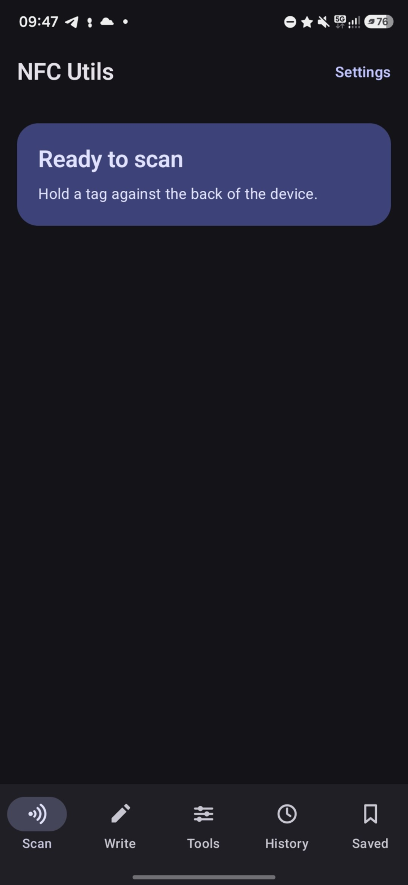
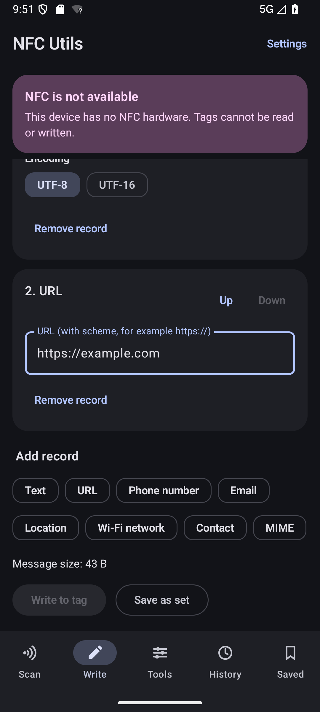

Android app for reading, writing, erasing, formatting and locking NFC tags, with an NDEF message composer and saved record sets.

## Dependencies

Runtime:

- Android 12 (API 31) or newer
- A device with NFC (the app installs without it and shows a notice)

Build:

- JDK 17 or newer
- Android SDK with platform 37 and matching build-tools

Libraries (versions are pinned in `gradle/libs.versions.toml`):

- Jetpack Compose and Material 3
- Navigation Compose
- AndroidX Lifecycle, Activity and Core KTX
- Room
- DataStore Preferences
- JUnit 4 (tests only)

## Build

Point Gradle at the Android SDK with the `ANDROID_HOME` environment variable or an `sdk.dir` entry in `local.properties`, then run:

```
./gradlew assembleDebug
```

The APK is written to `app/build/outputs/apk/debug/`.

Unit tests run on the JVM and do not need a device or a tag:

```
./gradlew testDebugUnitTest
```

## Screenshots




## Links

- Project website: https://nfcutils.anmitali.dev
- [CONTRIBUTING.md](CONTRIBUTING.md)

## License

GPL-3.0-only. See [LICENSE](LICENSE).
